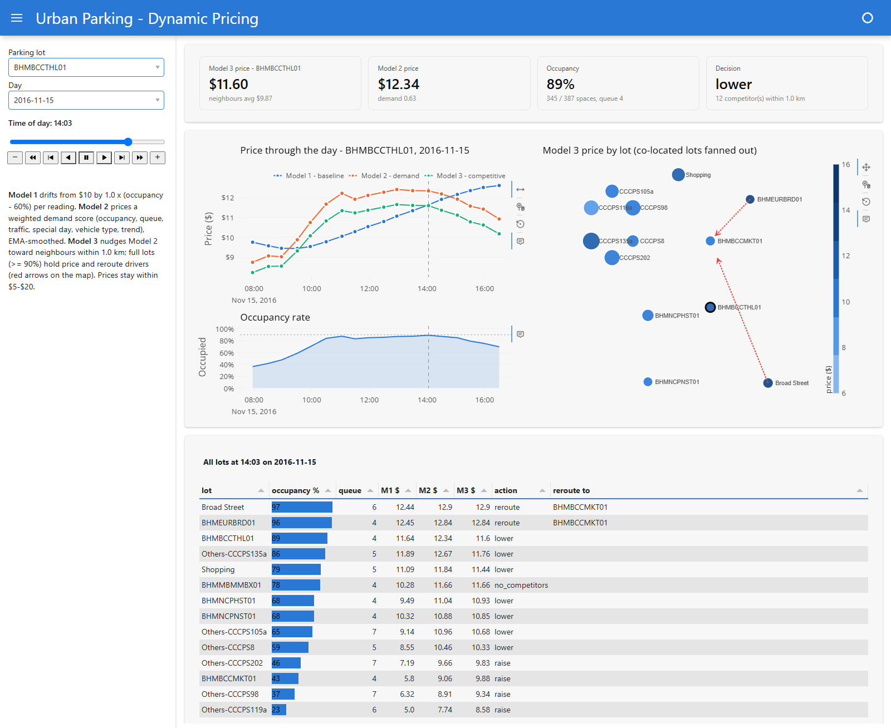
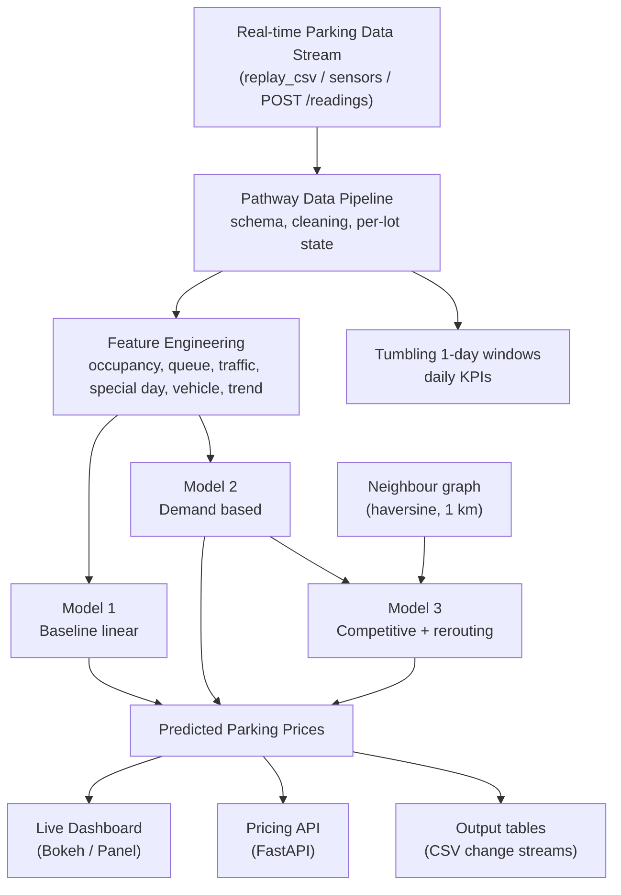

#  Dynamic Pricing for Urban Parking Lots

This project implements a **real-time dynamic pricing engine** for urban parking lots. Sensor
readings (occupancy, queue length, nearby traffic, special days, vehicle type) stream through a
[Pathway](https://pathway.com/) pipeline, three pricing models of increasing sophistication turn them
into prices, and the results are served through a live **Bokeh/Panel dashboard** and a **REST API**.



---

## Overview

Static parking prices cause congestion at popular lots and leave others empty. This engine
re-prices each of 14 lots every time a new reading arrives (~every 30 min), balancing occupancy
and revenue:

| Model | Idea | Uses |
|---|---|---|
| **1 - Baseline linear** | price drifts with occupancy vs. a target, resets daily | occupancy |
| **2 - Demand based** | weighted, normalised demand score, EMA-smoothed | occupancy, queue, traffic, special day, vehicle type, occupancy trend |
| **3 - Competitive** | nudges Model 2 toward nearby lots; full lots hold price and **reroute drivers** | Model 2 + lot locations |

The pipeline is powered by:
- a streaming framework (**Pathway**), with an equivalent in-process engine for platforms
  Pathway does not support,
- three explainable pricing models written in plain `numpy`/`pandas`-style Python,
- real-time feature engineering and window-based aggregation,
- interactive visualisation (**Bokeh + Panel**) and a **FastAPI** service.

---

## Quick start

```bash
git clone https://github.com/Aniruddha-Ray/Dynamic-Pricing-for-Urban-Parking-Lots.git
cd Dynamic-Pricing-for-Urban-Parking-Lots
python -m venv .venv && source .venv/bin/activate      # Windows: .venv\Scripts\activate
pip install -e ".[dashboard,api,dev]"                  # add ",stream" on Linux/macOS for Pathway

parking-pricing replay       # price the whole season -> outputs/prices.csv + model comparison
parking-pricing dashboard    # live dashboard on http://localhost:5006
parking-pricing api          # REST API on http://127.0.0.1:8000 (docs at /docs)
parking-pricing stream       # Pathway streaming pipeline (Linux/macOS/Docker)
pytest                       # test suite
```

**Pathway has no Windows wheels.** On Windows, run the streaming pipeline in Docker (or WSL/Colab):

```bash
docker build -t parking-pricing .
docker run --rm -v "$PWD/outputs:/app/outputs" parking-pricing stream
docker run --rm -p 5006:5006 parking-pricing dashboard --address 0.0.0.0 --no-browser
docker run --rm -p 8000:8000 parking-pricing api --host 0.0.0.0
docker run --rm --entrypoint pytest parking-pricing        # incl. Pathway parity tests
```

The notebook [`Dynamic Pricing for Urban Parking Lots.ipynb`](Dynamic%20Pricing%20for%20Urban%20Parking%20Lots.ipynb)
walks through the data, the models and the Pathway pipeline end to end (it runs on Colab as-is).

---

## Project Architecture and Workflow



1. **Data ingestion** - readings (timestamp, lot, occupancy, capacity, queue, traffic, vehicle
   type, special day) are streamed with `pw.demo.replay_csv`, or POSTed live to the API.
2. **Data preprocessing** ([`data.py`](parking_pricing/data.py)) - parse timestamps, normalise
   labels, drop invalid rows and report data-quality issues (see below).
3. **Feature engineering** ([`models.py`](parking_pricing/models.py)) - every feature is normalised
   to `[0, 1]` (trend to `[-1, 1]`) so no single raw unit dominates.
4. **Predictive modelling** - the three models below, implemented once as pure functions.
5. **Prediction pipeline** ([`pathway_pipeline.py`](parking_pricing/pathway_pipeline.py)) - every
   new reading updates its lot's price; Pathway keeps the state and emits the change stream.
   [`engine.py`](parking_pricing/engine.py) is the same logic as a small stateful Python object
   (used by the API, the dashboard and on Windows).
6. **Output handling** - live dashboard, REST API, and CSV change streams / summary tables.

### Pathway dataflow

```
readings ─┬─ groupby(lot, day) ─ sorted history ─ UDF: Models 1 & 2 ─┐
          │                                                           ├─ join ─ UDF: Model 3 ─► live_prices
          │        static neighbour pairs ── join ── neighbours' prices ┘
          └─ tumbling 1-day window per lot ─ occupancy/queue KPIs ─────────────────────────► daily_summary
```

The UDFs call the same functions as the in-process engine, and
[`tests/test_pathway_pipeline.py`](tests/test_pathway_pipeline.py) checks that both backends
produce **identical** prices (max abs. difference `0.0`).

---

## The pricing models

All parameters live in one frozen [`PricingConfig`](parking_pricing/config.py) (override with
`--config my.json`). Base price is **$10**; every price is clipped to **$5 - $20**.

**Model 1 - baseline linear.** Resets to the base price each morning and then

```
p_t = clip(p_(t-1) + α · (occupancy_rate_t − target))          α = 1.0, target = 60 %
```

**Model 2 - demand based.**

```
demand  = 0.55·occupancy + 0.20·queue − 0.10·traffic + 0.10·special_day + 0.05·vehicle + 0.10·trend
d_norm  = (demand − demand_min) / (demand_max − demand_min)                    ∈ [0, 1]
raw     = base · (1 + λ · (d_norm − d_neutral))                                λ = 1.5
p_t     = clip(0.5 · raw + 0.5 · p_(t-1))                                      EMA smoothing
```

`d_neutral` is the demand under "typical" conditions (60 % full, short queue, average traffic,
a car), so a typical reading is priced at exactly $10. Heavy nearby traffic *lowers* the price
(the lot is harder to reach); `trend` is the occupancy change since the previous reading.

**Model 3 - competitive.** Neighbours are lots within 1 km (haversine). Their Model 2 prices are
averaged with `1 / distance` weights and the lot closes 30 % of the gap. A lot that is ≥ 90 % full
**never undercuts**; it holds its price and suggests rerouting drivers to the neighbour with space
that minimises `price + $2/km × distance`. Neighbour prices are taken as of the same timestamp,
and all readings of one timestamp are processed together, so results do not depend on the order
in which sensors report.

### Results on the bundled dataset (14 lots, 73 days, 18,282 readings)

| Model | Mean price | Std | Corr. with occupancy | Mean step | At price bound | Revenue index* |
|---|---|---|---|---|---|---|
| 1 - Baseline | $8.80 | 2.09 | 0.70 | $0.19 | 7.3 % | 0.90 |
| 2 - Demand | $10.00 | 1.73 | **0.94** | $0.27 | 0 % | 1.05 |
| 3 - Competitive | $9.99 | 1.48 | 0.89 | $0.26 | 0 % | 1.03 |

\* `Σ price × occupancy` relative to a flat $10. This is a static proxy: it assumes demand does
not react to price, so it measures how well prices line up with busy periods, not a revenue forecast.

Model 1 only accumulates `occupancy − target`, so it keeps rising after a lot's peak and sinks to
the floor at quiet lots. Model 2 tracks demand closely without ever hitting the bounds. Model 3
trades a little of that responsiveness for prices that stay in line with the neighbourhood, and
issues 1,004 reroute suggestions (5.5 % of readings), almost all from the three lots that are
regularly full.

### Data quality fixes

The cleaning step surfaces issues the first version silently ignored:

- **86 duplicate readings** (same lot and minute, different vehicle type): collapsed to one.
- **241 readings with occupancy > capacity**: occupancy rate clipped to 100 %.
- **Lot `BHMMBMMBX01` is geocoded to (20.0, 78.0)**, the centroid of India, ~1,500 km from the
  others. It is priced normally but excluded from competition.

---

## REST API

| Method | Path | Description |
|---|---|---|
| `GET` | `/health` | status and number of lots priced |
| `GET` | `/lots` | lots with capacity, location and competitor list |
| `GET` | `/prices` | latest quote (all three models) for every lot |
| `GET` | `/prices/{lot_id}` | latest quote for one lot |
| `GET` | `/history/{lot_id}?day=YYYY-MM-DD` | priced history from the replayed season |
| `POST` | `/readings` | ingest new sensor readings, returns live quotes (stale/duplicate readings are rejected) |
| `GET` | `/config` | active pricing parameters |

```bash
curl -X POST localhost:8000/readings -H "content-type: application/json" -d '[
  {"lot_id": "BHMBCCTHL01", "timestamp": "2016-12-20T08:00:00", "occupancy": 380,
   "capacity": 387, "queue_length": 8, "traffic": "high"}]'
```

---

## Project structure

```
parking_pricing/
  config.py            all tunable parameters (PricingConfig)
  data.py              loading, cleaning, data-quality report, lot registry
  geo.py               haversine distance, neighbour graph
  models.py            Models 1-3 as pure functions (single source of truth)
  engine.py            stateful real-time engine (per-lot state, Model 3 at each instant)
  replay.py            stream a historical dataset through the engine
  pathway_pipeline.py  Pathway streaming pipeline + live Bokeh plot
  metrics.py           model comparison metrics
  dashboard.py         Panel dashboard
  api.py               FastAPI service
  cli.py               `parking-pricing` command
tests/                 unit, engine, API and Pathway-parity tests
dataset.csv            14 lots, 04 Oct - 19 Dec 2016
Dynamic Pricing for Urban Parking Lots.ipynb   walkthrough notebook
```

---

##  Tech Stack

| Category | Tools / Libraries |
|---------|-------------------|
| Programming Language | Python 3.10+ |
| Streaming Engine | [Pathway](https://pathway.com/) |
| Feature Engineering | `pandas`, `numpy`, `datetime` |
| Visualization | `bokeh`, `panel`, `matplotlib` (notebook) |
| Serving | `fastapi`, `uvicorn` |
| Notebook Interface | Google Colab / Jupyter |
| Quality | `pytest`, `ruff`, Docker |

---

## Future Improvements

- Model demand response (price elasticity) so revenue can be simulated rather than proxied, and
  tune the weights against it.
- Reinforcement learning for price optimisation on top of the simulator.
- Integrate live weather and traffic APIs to enrich features.
- Kafka/MQTT connector for real sensors (Pathway supports both) instead of CSV replay.
- A user-side mobile app for live prices, rerouting and booking.

## Contributors

- Aniruddha Ray

## References

- [Pathway documentation](https://pathway.com/developers/)
- [Bokeh](https://docs.bokeh.org/) and [Panel](https://panel.holoviz.org/) documentation
